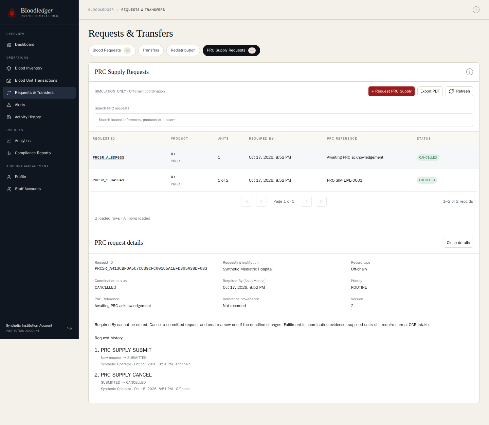
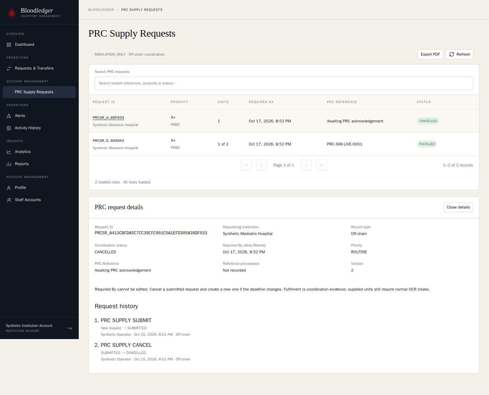

# Jopia host: approved live PRC validation — 2026-10-15

Classification: **SIMULATION_ONLY**. Policy: PA-DEF-06 `SYNTHETIC_PRC_SUPPLY_V1`
(ADR-044). Plan: Lat's
[LIVE-PLAN.md](../lat-prc-supply-2026-10-15/LIVE-PLAN.md), approved by Jopia on
2026-10-15 for both hosts. Executor: Jopia (self-validation). This is not PRC or
Mediatrix policy and makes no clinical, regulatory, production or ISBT 128 claim.

## Target and preparation

- **Host:** the Jopia host, retained `bloodledger_dev`.
- **Build:** API and web from `main` `8f6ff9a`, which contains #60 and #61.
  These ran in temporary containers on 3000/5174 with no worker, and were removed
  afterwards.
- **Migrations:** 32 applied, 0 pending.
- **Backup:** a fresh private `pg_dump` taken before the first action and
  checked readable with `pg_restore --list` (58 data sections). The path is kept
  privately.
- **Quiescent state:** no queued or active V2 commands and no worker or
  API containers running beforehand.
- **Reference:** `PRC-SIM-LIVE-0001` was unused, and there were no PRC rows (P0
  = 0).

## Deviation from the plan

The five writes used the same HTTP endpoints the UI calls: ordinary account
login, PIN-bound operator verification, and same-origin requests through the
5174 web proxy. They were not driven by UI clicks. Afterwards, both terminal
states were checked read-only in the UI through the ordinary login form; the
screenshots are below. No credential, PIN or verification ID was printed or
recorded.

## Results

Protected-state fingerprint, rechecked after every step:

- component count and a hash of every component's status, version and
  custodian;
- donation count;
- command count and a hash of every command's status;
- census snapshot and count rows;
- algorithm runs;
- source-surplus evidence.

| Step | Action | Result | Protected state | PRC rows / PRC audit |
|---|---|---|---|---|
| 1 | Mediatrix ROLE-02 submits A: A+ PRBC, 2 units, ROUTINE, Required By 2026-10-17T12:52Z | SUBMITTED v1, reference null, `replayed: false`, ledger NOT_APPLICABLE | Unchanged | 1 / 1 |
| 2 | PRC reviewer acknowledges A with `PRC-SIM-LIVE-0001` | ACKNOWLEDGED v2, provenance PRC_RECORDED_IN_SYSTEM | Unchanged | 1 / 2 |
| 3 | PRC reviewer fulfils 1 unit | FULFILLED v3, "1 of 2", closed | Unchanged | 1 / 3 |
| 3r | One explicit identical retry of step 3 | `replayed: true`, still v3, no new write | Unchanged | 1 / 3 |
| 4 | Mediatrix submits B: same product, 1 unit | SUBMITTED v1, new distinct ID | Unchanged | 2 / 4 |
| 5 | Mediatrix cancels B | CANCELLED v2, reference null, closed | Unchanged | 2 / 5 |

- **Final reads:** Mediatrix sees 2 rows (`INSTITUTION`); PRC sees 2 rows
  (`PRC_ALL`).
- **History A:** SUBMIT, ACKNOWLEDGE, FULFIL.
- **History B:** SUBMIT, CANCEL.
- **Unchanged:** both Required By values; actors show synthetic display names;
  timestamps keep their milliseconds.
- **Retained counts afterwards:** 531 components and 606 commands, the same as
  before.
- **Request IDs:**
  - A: `PRCSR_595E13AD41C49AB361F5C16511722DFDA98A58A3`
  - B: `PRCSR_A413CBFDA5C7CC39CFC001C5A1EFD305A38DF033`

The census, algorithm and source-surplus tables are empty on this host, so for
them "unchanged" only shows that nothing was written.

These records **persist**. There is no undo: cancellation and fulfilment are
terminal coordination states, not deletions, and fulfilment put no unit into
stock.

## UI observations for Lat (non-blocking)

- The CANCELLED badge uses the same green as FULFILLED. A neutral or muted tone
  would avoid presenting a cancellation as a success.
- In the PRC account's sidebar, the "Account management" section heading
  appears twice.
